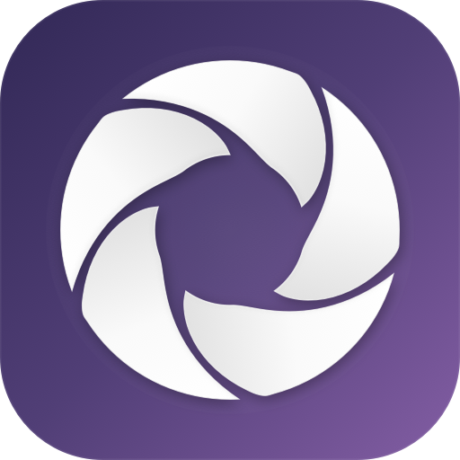
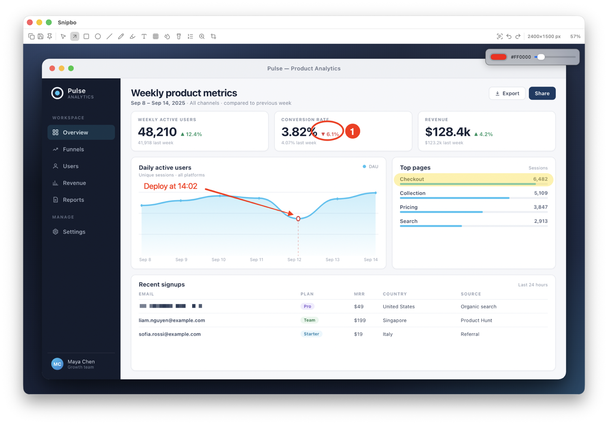
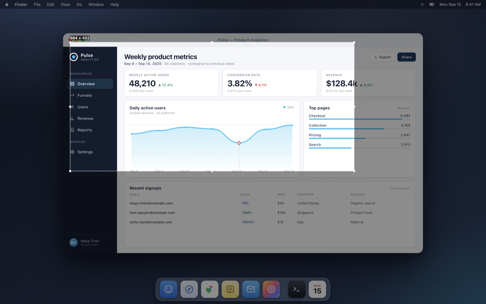
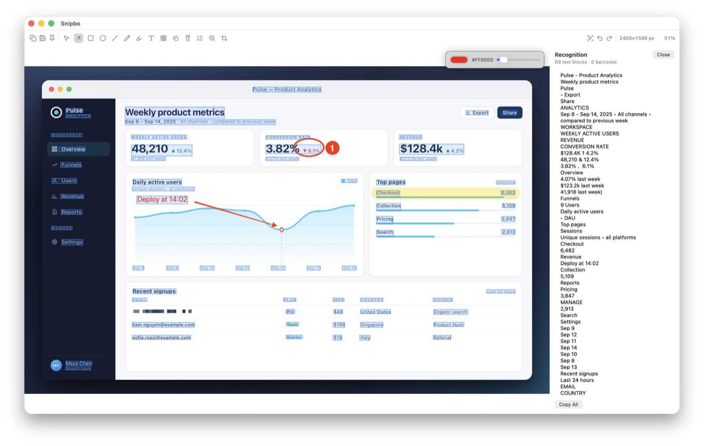
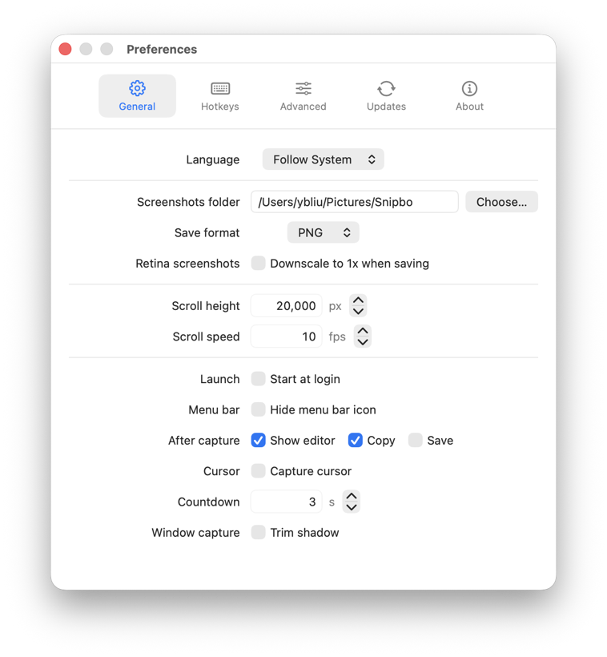

<div align="center">
  
  <h1>Snipbo</h1>
  <p><strong>截完就能发。</strong> 一个常驻菜单栏的 macOS 截图与标注工具，截图、标注、OCR、贴图全部在本机完成。</p>
  <p>
    
    
    
    
  </p>
</div>

Snipbo 把「截图 → 标注 → 交付」压缩成一次快捷键：按下默认的 `⌘⇧7` 冻结画面、拖拽框选，在编辑器里直接标好，按 `Enter` 复制、`⌘S` 保存，或把图片直接拖进其他应用。OCR、隐私打码、滚动长截图、导出、贴图和 MP4/GIF 录制都用 Apple 系统框架在本机完成；历史可以按截图中文字搜索。应用不发起任何网络请求，不上传、不统计、不需要账户。



<p align="center"><sub>17 种标注工具、浮动样式面板、像素化、测量与 OCR 都在同一个编辑器里。截图中「Pulse」为演示内容。</sub></p>

## 界面

| 框选 | OCR 与条码 |
| :---: | :---: |
|  |  |
| 冻结画面、八向手柄、实时尺寸，方向键可微调 | 识别块在画布上高亮，右侧面板展示并复制文本 |

<p align="center">
  
  <br>
  <sub>通用 / 快捷键 / 动作 / 高级 / 导出 / 录制 / 更新 / 关于，支持中英文界面、菜单栏配置与每个截图模式独立热键</sub>
</p>

## 功能

### 截图

| 模式 | 说明 | 默认快捷键 |
| --- | --- | --- |
| 区域截图 | 冻结画面后拖拽框选，可移动、调整八向手柄、方向键微调 | `⌘⇧7` |
| 窗口截图 | 悬停高亮窗口后点击捕获，可选裁掉窗口阴影 | 未设置 |
| 屏幕截图 | 捕获鼠标所在显示器 | 未设置 |
| 全部屏幕 | 捕获所有显示器并按物理排列拼接 | 未设置 |
| 延时截图 | 倒计时后执行区域或屏幕截图（默认 3 秒） | 未设置 |
| 延时窗口 | 倒计时后选择窗口截图 | 未设置 |
| 上次区域 | 复用上一次的选区直接截图 | 未设置 |
| 滚动截图 | 框选区域后滚动内容，自动对齐并拼接长图 | 未设置 |
| 横向滚动 | 框选区域后横向滚动，自动拼接宽图 | 未设置 |
| 自动滚动 | 自动发送滚轮事件并拼接，到内容末尾自动结束 | 未设置 |
| 应用全部窗口 | 捕获当前应用的所有可见窗口并合成一张透明背景图 | 未设置 |
| 录制区域 | 框选区域录制为 MP4 或 GIF | 未设置 |
| 录制屏幕 | 录制指针所在的显示器 | 未设置 |

区域选择时：

- 拖拽创建选区，拖动选区可移动。
- `方向键` 移动 1 pt，`Shift + 方向键` 移动 10 pt。
- `Option + 方向键` 调整对应方向的边界。
- `Enter` 确认，`Esc` 取消。
- 可在设置中开启窗口边缘吸附，锁定 1:1 / 4:3 / 16:9 比例或固定尺寸。
- 菜单栏「区域预设」可把上次选区保存为命名预设，之后直接复用；预设与显示器布局绑定。
- 滚动截图支持纵向、横向和自动滚动；自动滚动时请把指针停在要滚动的区域上，到内容末尾会自动结束。
- 「应用全部窗口」会把当前应用的所有可见窗口按前后顺序合成，窗口之间保持透明。

滚动截图使用 Vision 做帧间对齐；横向模式会把帧旋转 90° 复用纵向拼接，结束后再转回。默认 10 fps、最大拼接长度 20,000 px，可在设置中调整。自动滚动会发送滚轮事件，到内容末尾自动结束；对齐置信度不足时保留已捕获内容并提示。

### 编辑器

支持 17 种工具：选择、箭头、矩形、椭圆、直线、测量、多边形、画笔、荧光笔、文字、像素化、像素画笔、模糊、聚光灯、序号、放大镜、裁剪。浮动样式面板提供取色板、颜色、线宽、实线/虚线、形状填充和箭头样式控制，可以拖离画布角落；线宽和字号读数可直接键入数值（单位 px）。文字支持字体、字号、粗体、对齐、背景与描边。多边形单击加点、双击或 Enter 闭合。选择工具支持 Shift 多选、批量移动/删除/改样式、复制粘贴标注、再制、对齐与分布，方向键可微调。裁剪不会栅格化标注，所有操作可撤销/重做（最多 50 步）。

用选择工具在空白画布上拖拽，可以把当前图片直接拖进 Finder、微信、Slack 或浏览器。历史网格和贴图窗口也支持拖出。

单键切换工具：

| 键 | 工具 | 键 | 工具 |
| --- | --- | --- | --- |
| `V` | 选择 | `P` | 像素化 |
| `A` | 箭头 | `B` | 模糊 |
| `R` | 矩形 | `F` | 聚光灯 |
| `O` | 椭圆 | `C` | 序号 |
| `L` | 直线 | `M` | 放大镜 |
| `U` | 测量 | `K` | 裁剪 |
| `G` | 多边形 | `J` | 像素画笔 |
| `D` | 画笔 | `T` | 文字 |
| `H` | 荧光笔 | | |

编辑器快捷键：

| 快捷键 | 动作 |
| --- | --- |
| `Enter` / `⌘C` | 复制并关闭 |
| `⌘S` | 保存到默认目录并关闭 |
| `⌘⇧S` | 另存为 |
| `Esc` | 关闭；可在设置中选择关闭前自动复制和/或保存（裁剪中按 Esc 则取消裁剪） |
| `⌘Z` / `⌘⇧Z` | 撤销 / 重做 |
| `⌘P` | 作为贴图置顶 |
| `0` / `1` | 适应窗口 / 实际大小 |
| `Tab` | 复制当前颜色（`#RRGGBB`） |
| `Delete` | 删除选中的标注 |
| `⌘A` | 全选标注 |
| `⌘D` | 再制选中标注 |
| `⌘⌥C` / `⌘⌥V` | 复制 / 粘贴标注 |
| `⌘⇧R` | 打码敏感文本（邮箱、电话、证件/卡号等） |
| `⌘⇧F` | 打码人脸 |
| `⌘⇧A` | 打码全部文字 |
| `方向键` / `⇧方向键` | 移动选中标注 1 pt / 10 pt |
| `⇧P` | 切换逻辑点 / 像素读数 |

单键工具、`0`/`1`、`Tab`、`Delete` 在画布聚焦时生效；正在编辑文字时，`Enter` 提交文字、`Esc` 取消文字编辑。

### OCR 与条码

使用 Vision 在本机识别当前编辑图上的文字与条码（QR、Aztec、Data Matrix、PDF417、常见一维码等）：

- 支持简体中文与英语，可同时启用。
- 识别块在画布上高亮，右侧面板展示文本；可一键复制全部（含条码内容），也可选中部分复制。
- 可选去除文本中的换行。
- 识别在后台串行执行，关闭编辑器即取消。

### 隐私打码

编辑器工具栏的盾牌按钮或快捷键提供三种本机打码：敏感文本（邮箱、电话、证件/卡号等）、人脸、全部文字。识别只针对原图，不会把已有标注的文字再识别一遍；生成的像素化标注可整体撤销。

### 贴图、历史与设置

- **贴图**：把截图或历史图片变成无边框置顶窗口；拖动移动、滚轮缩放、`⌘C` 复制、`Esc` 关闭，右键可关闭全部。贴图会保存到本地并在下次启动时恢复；菜单栏「贴图」可显示或关闭单个/全部贴图，Option+拖拽可把贴图拖出。
- **最近截图**：菜单栏子菜单直接访问最近的历史条目。
- **菜单栏**：状态菜单集中了各截图模式、区域预设、最近截图、历史和贴图入口。除设置、菜单项和退出外，每个条目都可以在菜单的「菜单项」子菜单或设置的「菜单项…」里隐藏，选择会保存。
- **历史浏览**：网格浏览历史，可按 OCR 文字或标签搜索，按来源和时间筛选，收藏和添加标签；双击重新编辑会恢复上次的裁剪和标注；右键贴图、复制、在 Finder 中显示或删除，可一键清空。
- **设置**：通用 / 快捷键 / 动作 / 高级 / 导出 / 录制 / 更新 / 关于八个分页；支持中英文界面、每个截图模式独立热键、每模式截图后动作（打开编辑器/复制/保存/贴图）、录制格式与帧率、开机启动、隐藏菜单栏图标、Retina 缩至 1x、退出时清空历史等。界面固定使用深色主题。

历史原图以 PNG 明文保存在本地 `~/Library/Application Support/Snipbo/History`；如果编辑过，裁剪和标注会另存为同名 `<id>-document.json` 快照。贴图保存在 `~/Library/Application Support/Snipbo/Pins`。可在设置的“高级”页开启“退出时清空历史”，或在历史浏览中删除。

### 导出

- 保存格式支持 PNG、JPEG、HEIC、AVIF；JPEG/HEIC/AVIF 可设置质量。
- 可设置目标文件大小（KB），在保持可读性的前提下自动降低质量。
- 文件名模板支持 `{date}`、`{time}`、`{datetime}`、`{source}`、`{app}`、`{window}`、`{n}`。
- 可添加文字水印（位置、透明度可调），或开启美化导出（留白、背景、圆角、阴影）。水印和美化只作用于复制/保存输出，贴图和历史保持原图。

### 录制

- 菜单栏「录制」可录制区域或指针所在的屏幕；区域录制复用框选界面。
- 支持 MP4（H.264）和 GIF；帧率、最长时长、GIF 宽度在设置「录制」分页调整。
- GIF 最多 300 帧，到达上限会自动结束；录制不含音频。
- 录制文件保存到截图文件夹，不进入历史。录制控制条可停止或取消，也可用 `snipbo://capture?mode=record-stop` / `record-cancel` 或 CLI 停止。

### 自动化

- URL Scheme：`snipbo://capture?mode=region&action=copy`、`snipbo://settings`、`snipbo://history`。`mode` 支持 `region`、`window`、`app-windows`、`screen`、`all`、`timed-region`、`timed-screen`、`timed-window`、`last`、`scrolling`、`scroll-horizontal`、`scroll-auto`、`record-region`、`record-screen`、`record-stop`、`record-cancel`；`action` 支持 `editor`、`copy`、`save`、`pin`（可逗号组合）。录制可用 `format=mp4|gif` 覆盖本次格式。
- CLI：构建后可用 `dist/snipbo capture --mode region --action copy`、`dist/snipbo capture --mode record-screen --format gif`、`dist/snipbo capture --mode record-stop`，或开发时 `swift run snipbo-cli --help`。Shortcuts/Raycast 可以直接“打开 URL”。

## 系统要求

- macOS 14.0 (Sonoma) 或更高版本。
- Apple Silicon（构建脚本默认只产出 arm64）。
- Swift 6 工具链。只安装 Command Line Tools 也能构建和测试，不需要完整 Xcode。

## 安装

### 下载

从 [GitHub Releases](https://github.com/Liuke618/snipbo/releases) 下载最新的 `Snipbo-<版本>-arm64.zip`，解压后把 `Snipbo.app` 拖入 `/Applications`；如果没有现成构建，按下面的步骤从源码构建。

应用未做公证，首次打开若被 Gatekeeper 拦截，请在 Finder 中右键应用选择“打开”。

### 从源码构建

```bash
git clone https://github.com/Liuke618/snipbo.git
cd snipbo
./scripts/build_app.sh
open dist/Snipbo.app
```

安装到应用目录：

```bash
cp -R dist/Snipbo.app /Applications/
open /Applications/Snipbo.app
```

`build_app.sh` 会执行 release 构建、组装 `.app`、复制 `Info.plist` 与图标，并完成签名。

### 屏幕录制权限

首次截图时 macOS 会请求“屏幕录制”权限，请在 系统设置 → 隐私与安全性 → 屏幕录制 中允许 Snipbo。授权需要重启应用才生效；权限引导页提供了“重启 Snipbo”按钮。每次启动最多只会自动请求一次权限，之后未授权时显示引导页。

## 数据与隐私

- **设置**：`UserDefaults`，bundle id 为 `local.snipbo.app`。
- **历史**：`~/Library/Application Support/Snipbo/History/`，包含 `index.json`、原图 PNG、缩略图、可选的 `<id>-document.json` 标注快照，以及索引时写入的 OCR 文本；默认上限 200 条 / 500 MB，超出后按最旧优先清理。
- **贴图**：`~/Library/Application Support/Snipbo/Pins/`，PNG 与 `index.json`；关闭单个贴图或“关闭全部贴图”会删除对应文件。
- **截图保存目录**：默认 `~/Pictures/Snipbo`，可在设置中修改；录制文件也保存在这里。
- **录制**：MP4/GIF 文件按文件名模板写入保存目录，不进入历史，不含音频。
- **网络**：应用代码不包含 `URLSession`，不发起任何网络请求，无上传、遥测或崩溃上报。设置中的“打开 GitHub Releases”只是调用系统浏览器打开链接。URL Scheme 和 CLI 只在本机唤醒应用。
- **历史写入时机**：每次截图在交付（打开编辑器或直接复制/保存）时记录；编辑器内再次复制或保存不会产生重复条目。标注快照在编辑后防抖保存，关闭编辑器时立即保存。
- **搜索索引**：开启“本地索引截图文字”后，用 Vision 在本机识别并保存文本，仅用于历史搜索。

## 开发

### 目录结构

```
Sources/
  SnipboCore/     # 纯逻辑：文档模型、标注、渲染、导出、几何、历史、滚动拼接、设置
  SnipboApp/      # AppKit/SwiftUI：截图、编辑器、OCR、打码、贴图、历史、录制、设置
  SnipboCLI/      # 通过 snipbo:// URL 触发截图/打开的轻量 CLI
Tests/
  SnipboCoreTests/
Resources/           # Info.plist、AppIcon、Lucide 图标
scripts/             # 构建、签名、验证脚本
docs/                # 设计文档与阶段计划
```

`SnipboCore` 不依赖 UI，便于单元测试；所有 AppKit 对象与 UI 状态都在 `@MainActor` 上，截图、OCR、滚动帧处理与历史写盘在后台执行。

### 常用命令

```bash
swift build                 # debug 构建
swift test                  # Swift Testing 单元测试
swift run snipbo-cli --help # 查看命令行用法
./scripts/build_app.sh      # release 构建并打包到 dist/Snipbo.app，同时生成 dist/snipbo
```

应用图标由 `scripts/make_icon.swift` 按尺寸逐档矢量绘制（紫色渐变底 + 白色五叶风车），改动后重新生成并打包：

```bash
swift scripts/make_icon.swift
iconutil -c icns Resources/AppIcon.iconset -o Resources/AppIcon.icns
```

菜单栏图标是 `Resources/Icons/pinwheel.svg`，同一风车造型的单色 template 版本，缝隙加宽以适应 18 pt。

`swift run` 产出的未打包进程不能用于验证屏幕录制权限，TCC 相关测试请始终运行打包后的 `dist/Snipbo.app`。

仓库内还有几个不需要真实屏幕的验证脚本：

```bash
./scripts/run_editor_probe.sh          # 编辑器行为探针
./scripts/run_scroll_verify_harness.sh # 滚动拼接验证
./scripts/run_final_fix_harness.sh     # 截图交付路径验证
./scripts/run_surface_hit_probe.sh     # 工具栏与样式面板的点击命中链路
./scripts/run_status_menu_probe.sh     # 菜单项隐藏是否真正生效
./scripts/run_settings_render.sh       # 设置分页离屏渲染，检查排版
```

### 技术栈

- Swift 6（Swift 6 language mode）、SwiftPM
- AppKit + SwiftUI
- ScreenCaptureKit、Vision、Core Graphics、ImageIO
- Carbon 全局热键（`RegisterEventHotKey`）
- Swift Testing

## 已知限制

- 仅构建 arm64；未验证 Intel 与 macOS 14/15 的全部行为。
- 本机自用项目，不沙盒、不公证、不提供自动更新。
- “上次区域”和命名区域预设在显示器布局变化后失效，需要重新框选/保存。
- 不提供 WebP 编码（系统 ImageIO 没有编码器）；HEIC/AVIF 的可用性取决于 macOS 版本。
- 滚动截图依赖画面中的可对齐内容；纯色或极度重复的页面可能提前停止并保留已捕获部分。自动滚动要求指针停留在可滚动内容上，并且需要在 系统设置 → 隐私与安全性 → 辅助功能 中允许 Snipbo；未授权时可改用手动滚动。
- 录制只有画面、不含音频；GIF 最多 300 帧，较长内容请用 MP4。
- 超大长图受内存限制，可用“滚动高度”上限控制。
- `Snipbo` 为本地工作名，对外分发前应完成名称与商标检索。

## 原创性

本项目为原创实现，不基于任何反编译产物，不使用其他截图软件的代码、资源、字符串、图标或界面布局；交互上仅参考公开可见的通用截图习惯。

## 第三方资源

工具栏与菜单项图标来自 [Lucide](https://lucide.dev)，按 ISC 许可证使用，许可全文见 `Resources/Icons/LICENSE`；应用图标与菜单栏风车图标为本项目绘制。运行时仅使用 Apple 系统框架，无第三方依赖。

## 许可证

本项目代码以 MIT 许可证发布，全文见 `LICENSE`。`Resources/Icons` 中的图标仍按其 ISC 许可证使用。

## 请喝咖啡

如果这个项目对你有帮助，欢迎请我喝杯咖啡 ☕

| 微信 | 支付宝 |
| :---: | :---: |
|  |  |
